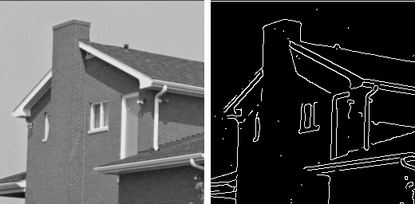
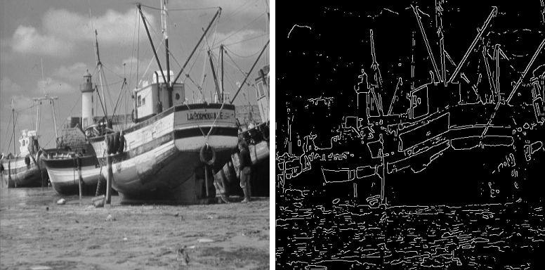
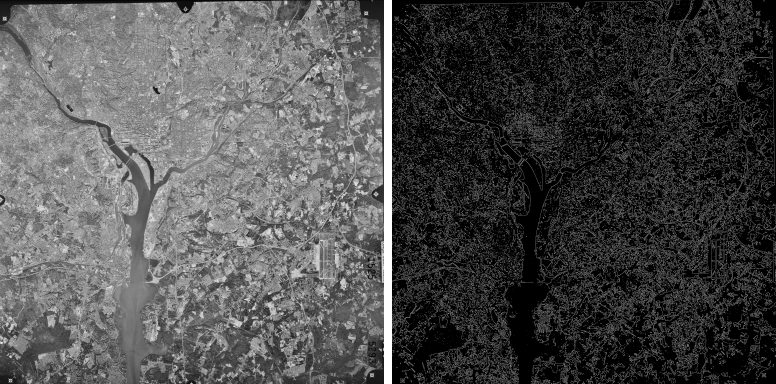

# GPU Batch Image Enhancement and Edge Detection with CUDA NPP

`npp_batch` is a command line tool that pushes a whole folder of images through
a GPU pipeline built from NVIDIA Performance Primitives (NPP) calls:

```
load -> upload -> RGB to gray -> [histogram equalize] -> [gaussian blur] -> [canny | sobel | sharpen]
     -> thumbnails (GPU resize) -> download -> save result + before|after image + timing log
```

It was run on **210 images from the USC-SIPI database** (87.2 megapixels in
total, from 256x256 up to 2250x2250) in a single execution. Every image,
the per-image timings and the console log are in [`output/`](output).

| | |
|---|---|
| Images processed | **210 / 210 ok** (misc 39, textures 64, aerials 38, sequences 69) |
| Pixels | 87.2 MP |
| GPU compute (all NPP calls) | 377.5 ms total, **259 MP/s** after the first image |
| Host -> device / device -> host | 58.2 ms / 98.6 ms |
| PNG decode / encode on the CPU | 2447.6 ms / 5800.3 ms |
| Wall time | 9.1 s |
| Hardware | RTX 4050 Laptop GPU (sm_89, 6 GB), CUDA runtime 12.9, NPP 12.4.1 |

| Before (gray) / after (equalize + gauss + canny) |
|---|
|  |
|  |
|  |

## What the pipeline does

All processing happens on the GPU through NPP. The CPU only decodes and
encodes PNG files and builds one 256-entry lookup table.

| Step | NPP calls | Notes |
|---|---|---|
| RGB -> gray | `nppiRGBToGray_8u_C3C1R_Ctx` | Skipped for images that are already gray. |
| `equalize` | `nppiHistogramEven_8u_C1R_Ctx`, `nppiLUTPalette_8u_C1R_Ctx` | 256-bin histogram on the GPU, CDF -> LUT on the host (256 values), LUT applied on the GPU. Spreads the gray levels over 0..255 so dark/flat images get usable contrast before edge detection. |
| `gauss` | `nppiFilterGaussBorder_8u_C1R_Ctx` | Mask 3..15 (`--gauss_size`), replicate border. Removes noise that would otherwise show up as edges. |
| `sharpen` | `nppiFilterSharpenBorder_8u_C1R_Ctx` | 3x3 sharpen. |
| `sobel` | `nppiFilterSobelHoriz/VertBorder_8u16s_C1R_Ctx`, `nppiAbs_16s_C1IR_Ctx`, `nppiAdd_16s_C1IRSfs_Ctx`, `nppiConvert_16s8u_C1R_Ctx` | Gradient magnitude \|Gx\| + \|Gy\| computed in 16 bits, then saturated back to 8 bits. |
| `canny` | `nppiFilterCannyBorderGetBufferSize`, `nppiFilterCannyBorder_8u_C1R_Ctx` | Sobel 3x3, L2 norm, thresholds `--canny_low` / `--canny_high`. |
| thumbnails | `nppiResize_8u_C1R_Ctx` (super sampling) | Shrinks the before/after pair to `--compare_height` so the proof images stay small. |

Memory comes from `nppiMalloc_8u_C1/C3` (pitched rows). The ops run in a
ping-pong between two buffers, so the gray "before" image is never
overwritten. Every NPP call uses the `_Ctx` API with one `NppStreamContext`.
GPU time is measured with CUDA events on that stream, and upload, compute and
download are timed separately.

## Repository layout

```
.
|-- Makefile                 build / run / lint on Linux (Coursera lab)
|-- run.sh                   data (first time) + build + run + pack proof
|-- src/
|   |-- main.cc              entry point: flags -> device info -> batch
|   |-- config.h/.cc         Config struct, flag parsing and validation
|   |-- image_io.h/.cc       PNG/JPG load + save (stb), folder listing
|   |-- gpu_image.h/.cc      RAII pitched GPU image, scratch buffer, error checks
|   |-- npp_ops.h/.cc        the NPP operations listed above
|   `-- pipeline.h/.cc       per-image processing, timing, CSV log, summary
|-- scripts/
|   |-- download_data.sh     fetch SIPI volumes and convert TIFF -> PNG
|   |-- convert_tiff.py      the TIFF -> PNG converter (Pillow)
|   |-- build_windows.ps1    Windows build without Visual Studio (see below)
|   `-- run_windows.ps1      Windows version of run.sh
|-- third_party/stb/        stb_image + stb_image_write (public domain)
|-- output/                  proof of execution from the run above
|-- .clang-format            Google style
`-- CPPLINT.cfg              cpplint settings
```

## Requirements

* NVIDIA GPU and driver
* CUDA toolkit 11 or newer with NPP (default `/usr/local/cuda`)
* g++ with C++17
* `curl`, `tar` and Python 3 with Pillow (only to download and convert the dataset)

## Build and run (Linux / Coursera lab)

```bash
./run.sh                       # download data if needed, build, run all images, pack proof
```

or step by step:

```bash
make data                      # scripts/download_data.sh -> data/sipi/*.png (210 images)
make                           # -> bin/npp_batch
./bin/npp_batch --input_dir=data/sipi --output_dir=output
make lint                      # cpplint on src/ (needs: pip install cpplint)
make clean
```

If CUDA is somewhere else: `make CUDA_PATH=/opt/cuda`.
Extra flags given to `run.sh` go to the program, e.g. `./run.sh --ops=equalize,sobel`.

## Build and run (Windows, no Visual Studio)

`nvcc` needs MSVC on Windows, but NPP and the CUDA runtime are plain C APIs.
So the host code can be compiled with MinGW-w64 g++ and linked straight against
the DLLs from NVIDIA's pip wheels (`nvidia-npp-cu12`, `nvidia-cuda-runtime-cu12`,
plus `nvidia-cuda-nvcc-cu12` for the `crt/` headers). The script installs them
into `tools/cuda`:

```powershell
powershell -ExecutionPolicy Bypass -File scripts\run_windows.ps1     # build + run + pack
powershell -ExecutionPolicy Bypass -File scripts\build_windows.ps1   # build only
```

The run in `output/` was made this way.

## Command line

```
./bin/npp_batch [--name=value ...]
```

| Flag | Default | Meaning |
|---|---|---|
| `--input_dir` | `data/sipi` | Folder with `.png .jpg .jpeg .bmp .pgm .ppm .tga` images |
| `--output_dir` | `output` | Where `images/`, `compare/` and `run_log.csv` are written |
| `--ops` | `equalize,gauss,canny` | Comma list, applied in order: `equalize`, `gauss`, `sharpen`, `sobel`, `canny` |
| `--gauss_size` | `5` | Gaussian mask size, odd, 3..15 |
| `--canny_low` | `60` | Canny low threshold |
| `--canny_high` | `150` | Canny high threshold |
| `--max_images` | `0` | Process only the first N images (0 = all) |
| `--compare_height` | `384` | Height of the before/after image (0 = full size) |
| `--no_compare` | off | Do not write the before/after images |
| `--device` | `0` | CUDA device id |
| `--help` | | Print usage |

Bad flags or values (unknown op, even mask size, `low >= high`, ...) print the
reason and the usage text, and exit with code 1. Exit code 2 means some images
failed.

Examples:

```bash
./bin/npp_batch --ops=equalize,gauss,sobel --gauss_size=7
./bin/npp_batch --ops=gauss,canny --canny_low=30 --canny_high=90 --max_images=50
./bin/npp_batch --input_dir=my_photos --output_dir=out_sharp --ops=sharpen --no_compare
```

## Output (proof of execution)

```
output/
|-- run.log                       full console output of the run
|-- run_log.csv                   one row per image: size, channels, load/upload/gpu/download/save ms, status
|-- images/<name>_after.png       full resolution result for each of the 210 images
`-- compare/<name>_before_after.png   gray input | result, side by side
```

`run.sh` (or `run_windows.ps1`) also packs this folder into
`proof_of_execution.tar.gz` for upload.

## Lessons learned

* **The GPU is not the bottleneck here, disk and PNG are.** NPP work was 377 ms
  of a 9.1 s run (about 4%). PNG decode and encode on one CPU thread took
  over 8 s. A real speedup would come from GPU decode (nvJPEG), threaded
  encoding, or overlapping I/O with GPU work using streams, not faster kernels.
* **The first image is always slow.** It took 41.6 ms of GPU time against about
  1 ms for the rest, because CUDA/NPP load their kernels lazily on first use.
  The summary reports the first image separately so it doesn't skew the
  throughput figure.
* **Laptop GPU timings are noisy.** The same 1024x1024 textures took about 1 ms
  each when run alone, but 3 to 7 ms each near the end of a full run. Splitting
  out "equalize only / +gauss / +canny" on aerials vs textures showed no content
  dependence, so this is clock/power management rather than the algorithm. The
  totals over many images are the meaningful numbers.
* **NPP API details that matter.**
  * The NPP functions without `_Ctx` are deprecated, so every call here takes
    an explicit `NppStreamContext`.
  * The LUT table for `nppiLUTPalette` must be in device memory.
  * `nppiHistogramEvenGetBufferSize` takes `int*` in older NPP and `size_t*` in
    newer NPP. A small template lets the compiler pick the right one, so the
    same code builds on the lab toolkit and on NPP 12.4.
* **8-bit Sobel loses half the edges.** The `_8u_C1R` Sobel clips negative
  gradients to 0, so dark-to-bright and bright-to-dark edges are not treated the
  same. Computing in 16 bits, taking the absolute value, adding and then
  saturating to 8 bits fixes that.
* **Checking the results.** Equalization was checked numerically: the dark
  `misc_4.1.02` went from mean 33 (range 1..244) to mean 121 (range 0..255).
  Canny and Sobel were checked visually in `compare/`.
* **Data format.** SIPI ships TIFF and stb cannot read TIFF, so the download
  script converts to PNG once (16-bit and palette images are reduced to 8-bit
  gray).
* **What I would change next.** Equalize and canny allocate their scratch
  buffers per image (`cudaMalloc`/`cudaFree`, and `cudaFree` synchronizes).
  Allocating them once at the largest image size, and processing several images
  on separate streams, would remove most of the per-image overhead.

## Troubleshooting

* `error while loading shared libraries: libnpp*.so`: run
  `export LD_LIBRARY_PATH=/usr/local/cuda/lib64:$LD_LIBRARY_PATH`.
* Link errors about `std::filesystem` with GCC 8: add `-lstdc++fs` to `LDFLAGS`
  in the Makefile.
* `no images found`: run `make data` first, or point `--input_dir` at a folder of images.

## Credits

* Images: [USC-SIPI Image Database](https://sipi.usc.edu/database/database.php)
  (volumes misc, textures, aerials, sequences). Not redistributed here;
  `scripts/download_data.sh` fetches them.
* [stb_image / stb_image_write](https://github.com/nothings/stb) by Sean Barrett (public domain / MIT).
* [CUDA NPP](https://docs.nvidia.com/cuda/npp/) by NVIDIA.
